# Guía de Arquitectura Técnica — `trivia-educativa-v6`

> **Actualización 2026-11-20:** El frontend fue migrado completamente de Vanilla JS a **React 18 + Vite 7 + Tailwind CSS 3** (JavaScript ESM + JSX) con arquitectura MVC adaptada a componentes. Las credenciales ahora viven en `.env` (`VITE_*`). El backend (Supabase) se blindó mediante las migraciones en `supabase/migrations/` (001, 002, 003) — aplicar `supabase/APLICAR_TODO_EN_SUPABASE.sql` en el SQL Editor. La guía siguiente describe el estado original (Vanilla) como referencia histórica.

> Documento generado por lectura exhaustiva del código fuente existente. Refleja **únicamente** lo que está implementado en el repositorio. Donde el código es ambiguo, incompleto o no existe, se indica explícitamente.

---

## 1. Resumen General y Stack Tecnológico

### 1.1 Qué hace la aplicación (flujo funcional)

Es una **SPA de trivia educativa** con dos roles claramente diferenciados que conviven en la misma app:

**Rol Docente (panel de administración)**
1. Inicia sesión con email/contraseña (Supabase Auth).
2. Llega a un *Dashboard* con métricas (total de alumnos, partidas jugadas, efectividad), un gráfico de dona y exportación CSV global.
3. Gestiona **alumnos** (alta, foto de perfil vía Cloudinary), **materias** (alta/baja) y **preguntas** (alta con 1 respuesta correcta + 3 incorrectas, baja, listado).
4. Puede entrar al "Modo Alumno" (selector de perfil) y salir de él mediante **re-autenticación con contraseña**.
5. Un "Super Admin" (email fijo `admin@trivia.com`) ve una sección adicional para registrar nuevos docentes.

**Rol Alumno (modo tablet / "Modo Alumno")**
1. Elige su perfil (avatar con fallback a DiceBear robots).
2. Llega a un *Hub* con dos opciones: **Jugar** o **Dibujar**.
3. Si juega: elige **ciclo escolar** ("Primer Ciclo" / "Segundo Ciclo") y **materia** → se cargan preguntas filtradas → responde → ve resultados → se guarda el intento y se otorgan logros.
4. Si dibuja: lienzo HTML5 (`canvas`) → guarda la imagen en Cloudinary → la URL se persiste en Supabase → se otorga el logro "Pequeño Artista".
5. El docente puede consultar el **historial** de un alumno: partidas, dibujos, medallas y exportación CSV individual.

### 1.2 Stack tecnológico (según archivos de configuración)

| Capa | Tecnología | Evidencia |
|---|---|---|
| Lenguaje | **JavaScript (ESM, sin TypeScript)** | `"type": "module"` en `package.json`; archivos `.js` |
| Build / dev server | **Vite 7.x** | `vite`, `vite build`, `vite preview` en scripts; `index.html` apunta a `/src/main.js` |
| Estilos | **Tailwind CSS 3** + PostCSS + Autoprefixer | `tailwind.config.js`, `postcss.config.js`, directivas `@tailwind` en `style.css` |
| Backend / DB / Auth | **Supabase** (`@supabase/supabase-js` 2.x), esquema `app` | `src/services/supabase.js` con `createClient(..., { db: { schema: "app" } })` |
| Gráficos | **Chart.js 4.x** (declarado como dependencia npm **y** cargado por CDN en runtime) | `package.json` + `Dashboard.js` inyecta `https://cdn.jsdelivr.net/npm/chart.js` |
| Subida de imágenes | **Cloudinary** (upload preset *unsigned*, vía `fetch` + `FormData`) | `src/services/cloudinary.js` |
| Avatares por defecto | **DiceBear API** (`bottts`) — servicio externo, sin dependencia npm | URLs en `ProfileSelect.js`, `Dashboard.js`, `Patients.js` |
| Animación de confeti | **Lottie** referenciado por `window.lottie` — **no se carga en ningún archivo** | `Results.js` |
| Gestores de paquetes | **pnpm y npm conviven** (hay `pnpm-lock.yaml`, `package-lock.json` y `pnpm-workspace.yaml`) | archivos en raíz |
| Router | **Router propio**, casero (sin react-router ni similar), basado en History API | `src/router/index.js` |
| Gestión de estado | **Objeto singleton mutable** en memoria (sin Redux/Zustand/Context) | `src/state.js` |
| UI | **Template strings HTML + `innerHTML` + `addEventListener`** (sin React/Vue) | todas las páginas |

> **No existe** `vite.config.*`, `tsconfig.json`, `.eslintrc`, `.env`, `.env.example`, framework de testing ni configuración de lint.

### 1.3 Comandos disponibles (`package.json`)

| Comando | Acción |
|---|---|
| `npm run dev` / `pnpm dev` | Levanta el servidor de desarrollo de Vite |
| `npm run build` / `pnpm build` | Genera el bundle de producción en `dist/` |
| `npm run preview` / `pnpm preview` | Sirve localmente el bundle ya construido |

**No hay** scripts de `lint`, `test`, `format` ni `typecheck`.

Nota de build: `pnpm-workspace.yaml` declara `onlyBuiltDependencies: [esbuild]` y `package.json` incluye `allowScripts: { "esbuild@0.28.2": true }` — ajustes para permitir el script de instalación de esbuild (dependencia transitiva de Vite).

### 1.4 Variables de entorno

**No se usa ninguna variable de entorno.** No hay `.env`, `.env.example`, ni referencias a `import.meta.env` / `process.env` en el código (verificado por búsqueda en `src/`).

 Las credenciales y endpoints están **hardcodeados** en el código fuente:

| Dato | Archivo | Valor (parcialmente mostrado) |
|---|---|---|
| URL de Supabase | `src/services/supabase.js:4` | `https://gddpceumixxwrbejgotd.supabase.co` |
| Anon key de Supabase | `src/services/supabase.js:5-6` | JWT `eyJhbGciOi...` (clave pública `anon`, expira en 2035) |
| Cloud name de Cloudinary | `src/services/cloudinary.js:4` | `dzsbrf05n` (con comentario `⚠️ REEMPLAZA ESTO CON TUS DATOS`) |
| Upload preset de Cloudinary | `src/services/cloudinary.js:5` | `trivia_dibujos` (preset unsigned) |
| Email del Super Admin | `src/pages/Dashboard.js:17` | `admin@trivia.com` |
| URL del gráfico Chart.js | `src/pages/Dashboard.js:268` | CDN jsDelivr |
| URL de animación Lottie | `src/pages/Results.js:77` | `assets3.lottiefiles.com/.../lf20_obhph3sh.json` |

> ⚠️ Punto sensible: la `anon key` es pública por diseño en Supabase, pero al estar hardcodeada debe ir acompañada de **Row Level Security (RLS)** en la base de datos. Las políticas RLS **no están en este repositorio**, por lo que no es posible verificar desde el código qué operaciones están realmente protegidas.

---

## 2. Árbol Completo de Archivos

Se omite `node_modules/`, `.git/`, `dist/`, `package-lock.json`, `pnpm-lock.yaml` y el asset `public/vite.svg` (favicon por defecto de Vite). Se menciona `public/` por ser la ubicación de assets.

```text
trivia-educativa-v6/
├── .gitignore                          # Ignora node_modules, dist, logs y archivos de editor
├── index.html                          # HTML raíz: monta <div id="app"> y carga /src/main.js
├── package.json                        # Manifest: scripts dev/build/preview y dependencias
├── postcss.config.js                   # Configura plugins Tailwind + Autoprefixer
├── tailwind.config.js                  # Paleta personalizada (primary/secondary/accent/bg)
├── pnpm-workspace.yaml                 # Permite compilar esbuild (onlyBuiltDependencies)
├── public/
│   └── vite.svg                        # Asset estático: favicon por defecto de Vite
└── src/
    ├── main.js                         # Punto de entrada: espera DOMContentLoaded y renderiza la ruta
    ├── state.js                        # Estado global singleton (user, patient, subject, cycle, score)
    ├── components/
    │   ├── Modal.js                    # Modal genérico de confirmación inyectado en <body>
    │   └── ReAuthModal.js              # Modal que pide contraseña para acciones de docente
    ├── pages/
    │   ├── Dashboard.js                # Panel docente: métricas, gráfico, accesos y exportación CSV
    │   ├── Game.js                     # Motor de la trivia: carga preguntas, puntúa y navega
    │   ├── Login.js                    # Inicio de sesión docente
    │   ├── PatientHistory.js           # Historial de un alumno: logros, partidas, dibujos, CSV
    │   ├── Patients.js                 # Alta de alumnos, lista y subida de foto (Cloudinary)
    │   ├── ProfileSelect.js            # Selector de perfil ("¿Quién eres?") del modo alumno
    │   ├── QuestionForm.js             # Formulario para crear pregunta + 4 respuestas
    │   ├── QuestionManager.js          # Tabla de preguntas con alta y baja
    │   ├── RecreationZone.js           # Lienzo de dibujo (canvas) y guardado en Cloudinary
    │   ├── Results.js                  # Pantalla final: guarda intento, logros y confeti
    │   ├── StudentHub.js               # Hub del alumno: elegir entre Jugar y Dibujar
    │   ├── SubjectManager.js           # Alta y baja de materias
    │   ├── SubjectSelect.js            # Configura ciclo + materia antes de jugar
    │   └── TeacherManager.js           # Registro de nuevos docentes (solo Super Admin)
    ├── router/
    │   └── index.js                    # Router propio: tabla de rutas, guardias y render
    ├── services/
    │   ├── cloudinary.js               # Subida de imágenes base64 al preset unsigned
    │   └── supabase.js                 # Capa de datos: auth + CRUD de todas las entidades
    └── styles/
        └── style.css                   # Directivas Tailwind + estilos base del body
```

**Resumen de conteo:** 22 archivos de código (1 entrada, 1 estado, 1 router, 2 servicios, 2 componentes, 14 páginas, 1 estilo) + 6 archivos de configuración/raíz = **28 archivos analizados**. Assets en `public/`.

---

## 3. Mapa de Conexiones y Dependencias

### 3.1 Punto de entrada y cadena de arranque

1. El navegador carga **`index.html`**, que crea `<div id="app"></div>` y carga `/src/main.js` como módulo.
2. **`main.js`** importa `style.css` y `renderRoute`, y registra un listener `DOMContentLoaded` → llama a `renderRoute()`.
3. **`renderRoute()`** (en `router/index.js`):
   - Obtiene `#app` y `window.location.pathname`.
   - Llama a `getSession()` (Supabase Auth) y, si hay sesión, ejecuta `setUser(session.user)`.
   - Aplica **guardias de ruta**:
     - Sin sesión y ruta ≠ `/` → redirige a `/` y reemplaza el historial.
     - Con sesión y ruta === `/` → redirige a `/dashboard`.
   - Resuelve la página desde la tabla `routes` (por defecto `Login`).
   - Hace `app.innerHTML = await route.render()` y, si existe, llama a `route.init()`.
4. Cada página sigue el patrón **`{ render, init }`**: `render()` devuelve HTML (puede ser `async`), `init()` cablea eventos y cargas de datos.
5. La navegación entre páginas se hace con **`navigateTo(path)`**, que usa `history.pushState` + `renderRoute()`. El evento `popstate` también llama a `renderRoute()` (soporte de botón "atrás").

### 3.2 Diagrama de jerarquía y dependencias

```mermaid
flowchart TD
    HTML[index.html] --> MAIN[src/main.js]
    MAIN --> CSS[styles/style.css]
    MAIN --> ROUTER[router/index.js]

    ROUTER -->|render/init| LOGIN[pages/Login.js]
    ROUTER -->|render/init| DASH[pages/Dashboard.js]
    ROUTER -->|render/init| PATIENTS[pages/Patients.js]
    ROUTER -->|render/init| PROFILES[pages/ProfileSelect.js]
    ROUTER -->|render/init| HUB[pages/StudentHub.js]
    ROUTER -->|render/init| SUBJSEL[pages/SubjectSelect.js]
    ROUTER -->|render/init| GAME[pages/Game.js]
    ROUTER -->|render/init| RESULTS[pages/Results.js]
    ROUTER -->|render/init| RECREATION[pages/RecreationZone.js]
    ROUTER -->|render/init| HISTORY[pages/PatientHistory.js]
    ROUTER -->|render/init| QMANAGER[pages/QuestionManager.js]
    ROUTER -->|render/init| QFORM[pages/QuestionForm.js]
    ROUTER -->|render/init| SMANAGER[pages/SubjectManager.js]
    ROUTER -->|render/init| TMANAGER[pages/TeacherManager.js]

    ROUTER -->|getSession / setUser| SB[services/supabase.js]
    ROUTER --> STATE[state.js]

    LOGIN --> SB
    LOGIN --> STATE
    LOGIN --> ROUTER

    DASH --> SB
    DASH --> STATE
    DASH --> ROUTER
    DASH -.->|window.Chart vía CDN| CDN[cdn.jsdelivr.net/chart.js]

    PATIENTS --> SB
    PATIENTS --> CLOUD[services/cloudinary.js]
    PATIENTS --> STATE
    PATIENTS --> REAUTH[components/ReAuthModal.js]
    PATIENTS --> ROUTER

    PROFILES --> SB
    PROFILES --> STATE
    PROFILES --> REAUTH
    PROFILES --> ROUTER

    HUB --> STATE
    HUB --> REAUTH
    HUB --> ROUTER

    SUBJSEL --> SB
    SUBJSEL --> STATE
    SUBJSEL --> MODAL[components/Modal.js]
    SUBJSEL --> ROUTER

    GAME --> SB
    GAME --> STATE
    GAME --> MODAL
    GAME --> ROUTER

    RESULTS --> SB
    RESULTS --> STATE
    RESULTS --> ROUTER
    RESULTS -.->|window.lottie NO cargado| LOTTIE[lottiefiles]

    RECREATION --> SB
    RECREATION --> CLOUD
    RECREATION --> STATE
    RECREATION --> MODAL
    RECREATION --> ROUTER

    HISTORY --> SB
    HISTORY --> STATE
    HISTORY --> ROUTER

    QMANAGER --> SB
    QMANAGER --> ROUTER
    QFORM --> SB
    QFORM --> MODAL
    QFORM --> ROUTER
    SMANAGER --> SB
    SMANAGER --> ROUTER
    TMANAGER --> SB
    TMANAGER --> STATE
    TMANAGER --> ROUTER

    REAUTH --> SB
    REAUTH --> STATE

    SB --> EXT[(Supabase<br/>schema: app)]
    CLOUD --> CEXT[(Cloudinary API)]
```



### 3.3 Tabla de rutas (definidas en `router/index.js`)

| Ruta | Página | Propósito |
|---|---|---|
| `/` | `Login` | Acceso docente |
| `/dashboard` | `Dashboard` | Panel de administración |
| `/patients` | `Patients` | Gestión de alumnos |
| `/subjects` | `SubjectSelect` | Elegir ciclo + materia (config partida) |
| `/game` | `Game` | Partida de trivia |
| `/questions` | `QuestionManager` | Gestor de preguntas |
| `/question-form` | `QuestionForm` | Alta de pregunta |
| `/recreation` | `RecreationZone` | Zona de dibujo |
| `/results` | `Results` | Resultados de la partida |
| `/history` | `PatientHistory` | Historial del alumno |
| `/profiles` | `ProfileSelect` | Selector de perfil alumno |
| `/student-hub` | `StudentHub` | Hub del alumno |
| `/subject-manager` | `SubjectManager` | Gestor de materias |
| `/teacher-manager` | `TeacherManager` | Registro de docentes |

### 3.4 Cómo se conectan los módulos

- **`services/supabase.js`** es el único punto de acceso a datos. Expone una instancia `supabase` (usada directamente por `Dashboard` para la exportación CSV) y funciones de dominio que devuelven siempre un objeto `{ ok, data }` o `{ ok, error }` mediante los helpers `_ok()` / `_fail()`.
- **`state.js`** es un objeto compartido importado por casi todas las páginas. No es reactivo: los cambios se reflejan porque cada `navigateTo()` vuelve a renderizar la página completa.
- **`components/Modal.js`** y **`components/ReAuthModal.js`** inyectan HTML directamente en `document.body` (fuera de `#app`), con `z-index` 100 y 200 respectivamente.
- **`navigateTo()`** es importado por todas las páginas (la mayoría de forma estática; `SubjectSelect` lo importa dinámicamente dentro del callback del modal).
- **`cloudinary.js`** es usado por `Patients` (fotos de perfil) y `RecreationZone` (dibujos).

---

## 4. Flujo de Datos y Gestión de Estado (El "Cómo funciona")

### 4.1 Origen de los datos

**No hay datos locales (JSON/TS) ni base de datos embebida.** Toda la información persistente vive en **Supabase** (esquema `app`) y se accede por red:

| Entidad | Tabla Supabase | Funciones en `supabase.js` |
|---|---|---|
| Autenticación | `auth.users` (Supabase Auth) | `getSession`, `login`, `registerTeacher`, `logout` |
| Alumnos | `pacientes` | `getPatientsList`, `createPatient`, `updatePatientAvatar` |
| Materias | `materias` | `getSubjectsList`, `createSubject`, `deleteSubject` |
| Preguntas | `preguntas` | `getAllQuestions`, `createQuestionWithAnswers`, `deleteQuestion`, `getQuestionsForGame` |
| Respuestas | `respuestas` | (se insertan/consultan dentro de las funciones de preguntas) |
| Intentos de juego | `intentos` | `saveGameAttempt`, `getTeacherMetrics`, `getPatientHistory` |
| Dibujos | `dibujos` | `saveDrawingUrl`, `getPatientDrawings` |
| Logros | `logros`, `paciente_logros` | `checkAndAwardAchievement`, `getPatientAchievements` |

**Servicios externos adicionales:**
- **Cloudinary**: almacena los binarios de imágenes (fotos y dibujos). Supabase guarda solo la URL devuelta (`secure_url`). Nota: en `dibujos` la URL se guarda en la columna **`imagen_b64`**, nombre que sugiere que originalmente se guardaba base64 (posible deuda técnica).
- **DiceBear**: genera avatares SVG por defecto cuando el alumno no tiene foto. No persiste nada.
- **jsDelivr / LottieFiles**: recursos de UI cargados en runtime.

**Persistencia local (localStorage / sessionStorage):** **ninguna**. La sesión se maneja con las cookies/tokens de Supabase Auth; el resto del estado es solo en memoria y se pierde al recargar.

### 4.2 Recepción y transformación de datos

Toda la transformación ocurre en **`src/services/supabase.js`**, que mapea los nombres de columnas de la DB (snake_case, español) a un modelo interno (camelCase, inglés):

| Función | Transformación principal |
|---|---|
| `getPatientsList()` | `id_paciente\|\|id → id`, `nombre → patient_name`, `fecha_creacion\|\|created_at\|\|ahora → created_at` |
| `createPatient()` | Genera un **DNI aleatorio** (`Math.random()*100000000`) y guarda `creado_por = session.user.id` |
| `updatePatientAvatar()` | Actualiza `avatar_url` filtrando por `id_paciente` |
| `getSubjectsList()` | `id_materia → id`, `nombre → name`; ordena por `fecha_creacion` |
| `getAllQuestions()` | Join embebido a `materias` y `respuestas`; `texto_pregunta → text`, `ciclo → cycle`, `materias.nombre → subjectName`, respuestas a `{id, text, isCorrect}`; ordena descendente |
| `getQuestionsForGame(subjectId, cycle)` | **Filtra** por `id_materia` y `ciclo`; descarta preguntas con menos de 2 respuestas; mapea a `{id, text, answers[]}` |
| `createQuestionWithAnswers()` | Inserta la pregunta y luego las respuestas; **si falla el insert de respuestas, hace rollback borrando la pregunta** |
| `saveGameAttempt()` | Inserta en `intentos` con `puntaje_total = correct` |
| `getTeacherMetrics()` | Suma `respuestas_correctas/incorrectas` de **`creado_por === session.user.id`** y devuelve `{totalCorrect, totalIncorrect, totalAttempts}` |
| `checkAndAwardAchievement()` | Busca el logro por `nombre`, verifica que el alumno no lo tenga y lo inserta en `paciente_logros`; devuelve booleano |

En el **juego**, `Game.js` adicionalmente:
- Guarda las preguntas en `state.questions`.
- **Baraja las respuestas** con `[...answers].sort(() => Math.random() - 0.5)` en cada render de pregunta (método de shuffling estadísticamente sesgado, ver diagnóstico).
- Lee `data-correct` del botón clickeado (`"true"`/`"false"`) para decidir el incremento de puntaje.

### 4.3 Estado global y local

**Estado global** (`src/state.js`) — un singleton mutable con setters:

```js
state = {
  user: null,        // usuario de Supabase Auth (lo setea router/Login)
  patient: null,     // { id, name, avatarUrl } (lo setea ProfileSelect/Patients)
  subject: null,     // { id, name } (lo setea SubjectSelect)
  cycle: null,       // "Primer Ciclo" | "Segundo Ciclo" (lo setea SubjectSelect)
  score: { correct: 0, incorrect: 0 },
}
```

Setters: `setUser`, `setPatient`, `setSubject`, `setCycle`. Limpieza: `clearSession()` (resetea `user`, `patient`, `subject`, `cycle`).

**Campos dinámicos agregados por `Game.js`** (no declarados en `state.js`):
- `state.currentQuestionIndex` — índice de la pregunta actual.
- `state.questions` — array de preguntas de la partida.

> `state.score` **sí** está declarado en `state.js`, pero `Game.js` lo reinicia en cada partida. `clearSession()` **no** reinicia `score`, `currentQuestionIndex` ni `questions`.

**Estado local:** casi todo el resto es estado local de closures dentro de `init()` de cada página (p. ej. `localCycle` en `SubjectSelect`, `isDrawing`/`currentColor` en `RecreationZone`, `globalAttemptsData` en `PatientHistory`). No hay hooks ni frameworks.

**Comunicación entre componentes:** 100% por
- variables del módulo `state.js` (global),
- parámetros de funciones (`navigateTo(path)`, `showModal(title, msg, cb)`),
- eventos del DOM (`addEventListener` sobre IDs y clases), y
- `data-*` attributes (`data-id`, `data-name`, `data-cycle`, `data-correct`, `data-color`) para transportar datos desde el HTML generado.

### 4.4 Ciclo de vida de una partida (paso a paso técnico)

1. **Apertura de la app** — `main.js` → `renderRoute()` → `getSession()` → `setUser()`. Sin sesión, la ruta es `/` → `Login.render()` + `Login.init()`.
2. **Login** — `Login.init()` vuelve a chequear sesión; el submit llama a `login(email, password)`. Si `ok`, `setUser(result.data)` y `navigateTo('/dashboard')`.
3. **Entrar al modo alumno** — `Dashboard` → botón `btnModoAlumno` → `navigateTo('/profiles')` → `ProfileSelect.init()` carga `getPatientsList()` y pinta tarjetas. Al clickear una, `setPatient({id, name, avatarUrl})` → `navigateTo('/student-hub')`.
   - *Ruta alternativa docente:* desde `Patients.js`, el botón "▶ Jugar" llama `setPatient({id, name})` y va directo a `/subjects` (sin avatarUrl; `SubjectSelect` no lo necesita).
4. **Hub del alumno** — `StudentHub.init()` → botón "Jugar" → `navigateTo('/subjects')`.
5. **Configuración** — `SubjectSelect.init()` carga `getSubjectsList()`. El usuario elige ciclo (botones `.btn-cycle` → `localCycle`) y materia (`.btn-subject`). Al clickear materia: valida que haya ciclo, ejecuta `setCycle(localCycle)` + `setSubject({id, name})` (duplicado en el código, ver diagnóstico), y muestra `showModal(...)` cuyo callback (con `import()` dinámico del router) navega a `/game`.
6. **Carga del juego** — `Game.init()`:
   - Verifica `state.patient && state.subject && state.cycle`; si falta algo, muestra pantalla de error.
   - Reinicia `state.currentQuestionIndex = 0` y `state.score = {correct:0, incorrect:0}`.
   - Llama a `getQuestionsForGame(state.subject.id, state.cycle)`.
   - Si no hay preguntas, muestra mensaje y botón a `/subjects`.
   - Guarda `state.questions = result.data`.
7. **Cada pregunta** — `renderQuestion()`:
   - Toma `state.questions[state.currentQuestionIndex]`.
   - Mezcla las respuestas, pinta el enunciado y 4 botones `.btn-answer` con `data-correct`.
   - Al clickear: deshabilita todos los botones, compara `dataset.correct === "true"`, suma `state.score.correct` o `state.score.incorrect`, colorea la elegida (verde/rojo) y, si falló, resalta la correcta en verde. Muestra el botón "Continuar".
   - "Continuar": si quedan preguntas, `currentQuestionIndex++` y vuelve a `renderQuestion()`; si no, `navigateTo('/results')`.
8. **Resultados** — `Results.render()` calcula `total = correct + incorrect`, `finalScore = correct` y un mensaje según el rendimiento. `Results.init()`:
   - `await saveGameAttempt(patient.id, subject.name, cycle, correct, incorrect)` → inserta el intento en Supabase.
   - `await checkAndAwardAchievement(patient.id, "Primeros Pasos")`.
   - Si puntaje perfecto, `checkAndAwardAchievement(..., "Puntaje Perfecto")`.
   - Intenta animación Lottie si `window.lottie` existe (no se carga en ningún lado → confeti nunca se ve).
   - Botones: "Jugar otra materia" → `/subjects`; "Ir a Dibujar" → `/recreation`.
9. **Cierre / reingreso docente** — Desde pantallas de alumno, el botón de salida usa `requireTeacherAuth(cb)`: verifica `state.user`, muestra `ReAuthModal`, valida la contraseña con `login(state.user.email, pwd)` y solo entonces ejecuta la navegación a `/dashboard`.

---

## 5. Desglose Detallado: Archivo por Archivo

### `index.html`
- **Responsabilidad principal:** Documento raíz; define el contenedor de la SPA y carga el módulo inicial.
- **Recibe / Entradas:** Ninguna (HTML estático).
- **Devuelve / Exporta:** `<div id="app">`, `<script type="module" src="/src/main.js">`, favicon `/vite.svg`, `<html lang="en">`.
- **Se conecta con:** Carga `src/main.js`. Referencia `public/vite.svg`.
- **Lógica clave:** Ninguna. Nota: `lang="en"` aunque toda la UI está en español.

### `package.json`
- **Responsabilidad principal:** Definir scripts y dependencias.
- **Recibe / Entradas:** N/A.
- **Devuelve / Exporta:** `dev`, `build`, `preview`; dependencias `@supabase/supabase-js`, `chart.js`; devDeps `vite`, `tailwindcss@3`, `postcss`, `autoprefixer`.
- **Se conecta con:** Vite, Tailwind, Supabase, Chart.js.
- **Lógica clave:** `type: module`; `allowScripts` para esbuild 0.28.2. Sin lint/test.

### `tailwind.config.js`
- **Responsabilidad principal:** Configurar Tailwind.
- **Recibe / Entradas:** N/A.
- **Devuelve / Exporta:** `content: ["./index.html", "./src/**/*.{js,html}"]` y paleta extendida: `primary #1e90ff`, `secondary #f59e0b`, `accent #ef4444`, `bg #eef8f6`.
- **Se conecta con:** Todas las páginas (usan `bg-primary`, `text-accent`, etc.).
- **Lógica clave:** Definición de colores del design system.

### `postcss.config.js`
- **Responsabilidad principal:** Registrar plugins de PostCSS.
- **Recibe / Entradas:** N/A.
- **Devuelve / Exporta:** `{ tailwindcss: {}, autoprefixer: {} }`.
- **Se conecta con:** `tailwind.config.js`, `style.css`, Vite.
- **Lógica clave:** Ninguna.

### `pnpm-workspace.yaml`
- **Responsabilidad principal:** Permitir la ejecución del script de build de esbuild bajo pnpm.
- **Recibe / Entradas:** N/A.
- **Devuelve / Exporta:** `onlyBuiltDependencies: [esbuild]`.
- **Se conecta con:** Gestor pnpm / Vite.
- **Lógica clave:** Ninguna.

### `.gitignore`
- **Responsabilidad principal:** Excluir artefactos generados y archivos locales.
- **Recibe / Entradas:** N/A.
- **Devuelve / Exporta:** Reglas para `node_modules`, `dist`, `dist-ssr`, `*.local`, logs, `.vscode`, `.idea`, `.DS_Store`.
- **Se conecta con:** Git.
- **Lógica clave:** Ninguna. Nota: **no ignora `.env`**, que no existe actualmente.

### `public/vite.svg`
- **Responsabilidad principal:** Asset estático (favicon por defecto de Vite).
- **Recibe / Entradas:** N/A.
- **Devuelve / Exporta:** SVG del logo de Vite.
- **Se conecta con:** `index.html` (`<link rel="icon">`).
- **Lógica clave:** Ninguna.

### `src/main.js`
- **Responsabilidad principal:** Bootstrap de la aplicación.
- **Recibe / Entradas:** Evento `DOMContentLoaded`.
- **Devuelve / Exporta:** Nada (efecto secundario).
- **Se conecta con:** Importa `styles/style.css` y `router/index.js`.
- **Lógica clave:** Registra `document.addEventListener("DOMContentLoaded", () => renderRoute())`.

### `src/styles/style.css`
- **Responsabilidad principal:** Hoja de estilos global.
- **Recibe / Entradas:** N/A.
- **Devuelve / Exporta:** Directivas `@tailwind base/components/utilities` y estilos base de `body` (`background #eef8f6`, font `system-ui`, `margin/padding 0`).
- **Se conecta con:** Importado por `main.js`.
- **Lógica clave:** Ninguna. Nota: no define la clase `.btn`, usada en `Game.js` y `Results.js`.

### `src/state.js`
- **Responsabilidad principal:** Almacén de estado global en memoria.
- **Recibe / Entradas:** Valores pasados por los setters desde las páginas y el router.
- **Devuelve / Exporta:** `state`, `setUser`, `setPatient`, `setSubject`, `setCycle`, `clearSession`.
- **Se conecta con:** Importado por `router/index.js`, `Login`, `Dashboard`, `Patients`, `ProfileSelect`, `StudentHub`, `SubjectSelect`, `Game`, `Results`, `RecreationZone`, `PatientHistory`, `ReAuthModal`, `TeacherManager`.
- **Lógica clave:** Objeto plano sin reactividad. `clearSession()` limpia `user/patient/subject/cycle` pero **no** `score` ni los campos dinámicos `currentQuestionIndex`/`questions`.

### `src/router/index.js`
- **Responsabilidad principal:** Enrutado cliente, guardias de autenticación y ciclo de render de páginas.
- **Recibe / Entradas:** `window.location.pathname`, eventos `popstate`, llamadas a `navigateTo(path)`.
- **Devuelve / Exporta:** `navigateTo`, `renderRoute`, tabla `routes` (interna).
- **Se conecta con:** Importa las 14 páginas, `getSession`/`supabase.js`, `setUser`/`state.js`. Es importado por todas las páginas.
- **Lógica clave:** `renderRoute()` espera `getSession()`, sincroniza usuario, aplica redirecciones de guardia, hace `app.innerHTML = await route.render()` y llama a `route.init()`. Registra `popstate`. `navigateTo()` usa `history.pushState`.

### `src/services/supabase.js`
- **Responsabilidad principal:** Capa de acceso a datos y autenticación (todo el CRUD de la app).
- **Recibe / Entradas:** Parámetros de cada función (credenciales, IDs, textos, puntajes). Lee la sesión activa donde hace falta.
- **Devuelve / Exporta:** `supabase` (cliente), `_ok`, `_fail`, y ~20 funciones de dominio (ver §4.1).
- **Se conecta con:** Importado por las 14 páginas, el router y `ReAuthModal`. Habla con Supabase (schema `app`).
- **Lógica clave:** Cliente creado con URL + anon key hardcodeadas. Patrón de retorno `{ok, data|error}`. Mapeo snake_case→camelCase. Rollback en `createQuestionWithAnswers`. Cálculo de métricas y otorgamiento de logros idempotente.

### `src/services/cloudinary.js`
- **Responsabilidad principal:** Subir imágenes en base64 al preset unsigned de Cloudinary.
- **Recibe / Entradas:** `base64Image` (data URL).
- **Devuelve / Exporta:** `uploadImageToCloudinary()` → `{ok:true, url}` o `{ok:false, error}`.
- **Se conecta con:** Importado por `Patients.js` y `RecreationZone.js`. Llama a `https://api.cloudinary.com/v1_1/{CLOUD_NAME}/image/upload`.
- **Lógica clave:** Construye `FormData` con `file` + `upload_preset`, `fetch` POST y parsea `secure_url`. Maneja errores de red.

### `src/components/Modal.js`
- **Responsabilidad principal:** Mostrar un modal de confirmación genérico.
- **Recibe / Entradas:** `title`, `message` (puede contener HTML), `onConfirm` (callback opcional).
- **Devuelve / Exporta:** `showModal()`.
- **Se conecta con:** Importado por `SubjectSelect`, `Game`, `Results`, `RecreationZone`, `QuestionForm`.
- **Lógica clave:** Anti-apilamiento (elimina `#custom-modal` previo), inyecta HTML en `<body>`, el botón "Aceptar" remueve el modal y ejecuta el callback.

### `src/components/ReAuthModal.js`
- **Responsabilidad principal:** Exigir la contraseña del docente antes de salir del modo alumno.
- **Recibe / Entradas:** `onSuccess` (callback a ejecutar tras validar).
- **Devuelve / Exporta:** `requireTeacherAuth()`.
- **Se conecta con:** Importa `login` de `supabase.js` y `state`. Importado por `Patients`, `ProfileSelect`, `StudentHub`.
- **Lógica clave:** Si no hay `state.user`, redirige a `/`. Inyecta `#reauth-modal` en `<body>`, valida con `login(state.user.email, pwd)`; si falla muestra error, limpia y re-enfoca el input. Soporta Enter y botón de cerrar.

### `src/pages/Login.js`
- **Responsabilidad principal:** Pantalla de inicio de sesión docente.
- **Recibe / Entradas:** Email y contraseña del formulario; sesión existente de Supabase.
- **Devuelve / Exporta:** `Login = { render, init }`.
- **Se conecta con:** Importa `login`, `getSession` (Supabase), `setUser` (state), `navigateTo` (router).
- **Lógica clave:** `init()` redirige a `/dashboard` si ya hay sesión; si no, cablea el submit con estados de carga y muestra errores.

### `src/pages/Dashboard.js`
- **Responsabilidad principal:** Panel de administración docente.
- **Recibe / Entradas:** `state.user.email` (para detectar Super Admin), datos de Supabase.
- **Devuelve / Exporta:** `Dashboard = { render, init }`.
- **Se conecta con:** Importa `logout`, `getTeacherMetrics`, `getPatientsList`, `supabase`, `getSession`, `clearSession`, `state`, `navigateTo`. Carga Chart.js por CDN.
- **Lógica clave:** Render condicional del bloque de Super Admin. `loadDashboardData()` usa `Promise.all` para métricas + alumnos, calcula efectividad, pinta los 4 alumnos recientes y crea un gráfico doughnut con `window.Chart`. Inyecta el script de Chart.js desde CDN si `window.Chart` no existe. Exporta CSV global consultando `intentos` con join a `pacientes` y filtrando por `creado_por = session.user.id`.

### `src/pages/Patients.js`
- **Responsabilidad principal:** Alta/listado de alumnos, cambio de foto y accesos a historial/dibujo/juego.
- **Recibe / Entradas:** Formulario de nombre, archivo de imagen, sesión (para `createPatient`).
- **Devuelve / Exporta:** `Patients = { render, init }`.
- **Se conecta con:** Importa 3 funciones de Supabase, `uploadImageToCloudinary`, `setPatient`/`state`, `navigateTo`, `requireTeacherAuth`.
- **Lógica clave:** `loadPatients()` re-renderiza la lista y re-cablea eventos (uno por botón). Subida de foto: `FileReader.readAsDataURL` → Cloudinary → `updatePatientAvatar` → recarga. Botones setean `state.patient` con distinto nivel de detalle según destino (sin `avatarUrl` en "Jugar"/"Historial"/"Dibujar").

### `src/pages/ProfileSelect.js`
- **Responsabilidad principal:** Selector visual de perfil alumno ("¿Quién eres?").
- **Recibe / Entradas:** Lista de pacientes de Supabase.
- **Devuelve / Exporta:** `ProfileSelect = { render, init }`.
- **Se conecta con:** Importa `getPatientsList`, `setPatient`, `navigateTo`, `requireTeacherAuth`.
- **Lógica clave:** Genera avatar DiceBear por defecto si no hay foto; al clickear guarda `{id, name, avatarUrl}` en estado y va a `/student-hub`. Botón "Panel de Control" usa re-auth para volver al dashboard.

### `src/pages/StudentHub.js`
- **Responsabilidad principal:** Menú central del alumno (Jugar / Dibujar).
- **Recibe / Entradas:** `state.patient`.
- **Devuelve / Exporta:** `StudentHub = { render, init }`.
- **Se conecta con:** Importa `state`, `navigateTo`, `requireTeacherAuth`.
- **Lógica clave:** Si no hay paciente muestra pantalla de error con botón de volver. "Cambiar Perfil" setea `state.patient = null` directamente (sin setter). "Jugar" → `/subjects`; "Dibujar" → `/recreation`; "Salir" → re-auth → `/dashboard`.

### `src/pages/SubjectSelect.js`
- **Responsabilidad principal:** Configurar ciclo escolar y materia antes de jugar.
- **Recibe / Entradas:** `state.patient` (guardia), materias de Supabase, clics en ciclo/materia.
- **Devuelve / Exporta:** `SubjectSelect = { render, init }`.
- **Se conecta con:** Importa `getSubjectsList`, `state`/`setSubject`/`setCycle`, `navigateTo`, `showModal`.
- **Lógica clave:** Selección de ciclo con manejo de clases CSS; valida que haya ciclo antes de aceptar materia; guarda `cycle` y `subject` en estado; modal con callback que hace `import()` dinámico de `navigateTo` para ir a `/game`. **Contiene llamadas duplicadas** a `setCycle`/`setSubject`.

### `src/pages/Game.js`
- **Responsabilidad principal:** Motor de la partida de trivia.
- **Recibe / Entradas:** `state.subject`, `state.cycle`, `state.patient` (guardias), preguntas desde Supabase.
- **Devuelve / Exporta:** `Game = { render, init }`.
- **Se conecta con:** Importa `getQuestionsForGame`, `state`, `navigateTo`, `showModal` (este último importado pero **no usado**).
- **Lógica clave:** Reinicia puntaje/índice, carga y filtra preguntas ya en el servicio, las guarda en `state.questions`, y define el closure `renderQuestion()` que mezcla respuestas, detecta aciertos vía `data-correct`, actualiza `state.score`, resalta la respuesta correcta y navega a `/results` al terminar.

### `src/pages/Results.js`
- **Responsabilidad principal:** Mostrar resultados y persistir el intento + logros.
- **Recibe / Entradas:** `state.patient`, `state.subject`, `state.cycle`, `state.score`.
- **Devuelve / Exporta:** `Results = { render, init }`.
- **Se conecta con:** Importa `saveGameAttempt`, `checkAndAwardAchievement`, `state`, `navigateTo`.
- **Lógica clave:** Calcula feedback según puntaje. En `init()` guarda el intento, otorga "Primeros Pasos" y condicionalmente "Puntaje Perfecto"; intenta cargar Lottie si `window.lottie` existe; botones a `/subjects` y `/recreation`.

### `src/pages/RecreationZone.js`
- **Responsabilidad principal:** Lienzo de dibujo y guardado de la imagen.
- **Recibe / Entradas:** `state.patient`, eventos de mouse/touch, selección de color.
- **Devuelve / Exporta:** `RecreationZone = { render, init }`.
- **Se conecta con:** Importa `saveDrawingUrl`, `checkAndAwardAchievement`, `uploadImageToCloudinary`, `state`, `navigateTo`, `showModal`.
- **Lógica clave:** Inicializa/redimensiona el canvas con fondo blanco; implementa dibujo con `mousedown/move/up` y `touchstart/move/end` usando `getPos()`; el color blanco actúa como goma (grosor 20 vs 5); al guardar: `canvas.toDataURL("image/png")` → Cloudinary → `saveDrawingUrl` → logro "Pequeño Artista" → modal → `/patients`.

### `src/pages/PatientHistory.js`
- **Responsabilidad principal:** Ver logros, partidas y dibujos de un alumno; exportar CSV individual.
- **Recibe / Entradas:** `state.patient.id`.
- **Devuelve / Exporta:** `PatientHistory = { render, init }`.
- **Se conecta con:** Importa `getPatientHistory`, `getPatientDrawings`, `getPatientAchievements`, `state`, `navigateTo`.
- **Lógica clave:** Tres cargas paralelas con `Promise.all` (`loadAchievements`, `loadAttempts`, `loadDrawings`). Guarda los intentos en `globalAttemptsData` para el botón "Exportar Excel", que genera un Blob CSV con BOM `\uFEFF`. Los logros asumen que `ach.logros` es un objeto con `nombre`, `descripcion`, `imagen_url`.

### `src/pages/QuestionManager.js`
- **Responsabilidad principal:** Listar y eliminar preguntas; acceder al formulario de alta.
- **Recibe / Entradas:** Preguntas y materias desde Supabase, confirmación de borrado.
- **Devuelve / Exporta:** `QuestionManager = { render, init }`.
- **Se conecta con:** Importa `getAllQuestions`, `deleteQuestion`, `getSubjectsList`, `navigateTo`.
- **Lógica clave:** `loadTable()` re-renderiza la tabla y re-cablea los botones de borrado (usa `confirm()` nativo). **Importa `getSubjectsList` pero no lo usa**. "Nueva Pregunta" → `/question-form`.

### `src/pages/QuestionForm.js`
- **Responsabilidad principal:** Crear una pregunta con 1 correcta y 3 incorrectas.
- **Recibe / Entradas:** Materias desde Supabase, campos del formulario.
- **Devuelve / Exporta:** `QuestionForm = { render, init }`.
- **Se conecta con:** Importa `getSubjectsList`, `createQuestionWithAnswers`, `navigateTo`, `showModal`.
- **Lógica clave:** Puebla el `<select>` de materias; construye el array `answers` con `isCorrect` en `true` solo para `ansCorrect`; llama a `createQuestionWithAnswers` y muestra modal de éxito/error.

### `src/pages/SubjectManager.js`
- **Responsabilidad principal:** Alta y baja de materias.
- **Recibe / Entradas:** Nombre de materia, confirmación de borrado.
- **Devuelve / Exporta:** `SubjectManager = { render, init }`.
- **Se conecta con:** Importa `getSubjectsList`, `createSubject`, `deleteSubject`, `navigateTo`.
- **Lógica clave:** `loadSubjects()` re-renderiza y re-cablea botones de borrado; el `confirm()` advierte que también se borrarán las preguntas (depende de cascade en DB). Formulario de alta con estados de carga.

### `src/pages/TeacherManager.js`
- **Responsabilidad principal:** Registrar nuevos docentes (UI visible solo para Super Admin en el Dashboard).
- **Recibe / Entradas:** Email y contraseña del formulario.
- **Devuelve / Exporta:** `TeacherManager = { render, init }`.
- **Se conecta con:** Importa `registerTeacher`, `logout`, `clearSession`, `navigateTo`.
- **Lógica clave:** Tras registrar, Supabase inicia sesión con el nuevo usuario; por eso el código hace `logout()` + `clearSession()` + va a `/`, con un `alert` informativo.

---

## 6. Diagnóstico del Estado Actual y Puntos Sensibles

### 6.1 Código muerto / imports sin usar / duplicados

| Ítem | Ubicación | Detalle |
|---|---|---|
| `showModal` importado pero nunca llamado | `Game.js:5` | No se usa en ningún punto del archivo. |
| `getSubjectsList` importado pero nunca llamado | `QuestionManager.js:5` | No se usa. |
| Llamadas duplicadas a `setCycle` / `setSubject` | `SubjectSelect.js:129-134` | Se ejecutan dos veces seguidas (con un comentario repetido entre ellas). Inofensivo pero indicativo de copia/pega. |
| Dependencia `chart.js` declarada en npm pero no importada | `package.json` + `Dashboard.js` | La app carga Chart.js desde CDN en runtime (`window.Chart`). La dependencia npm está sin uso real en el código. |
| `state.score` declarado en `state.js` pero reiniciado en `Game.js` | `state.js:7`, `Game.js:34` | Doble definición del ciclo de vida del puntaje. |
| Campos `currentQuestionIndex` y `questions` no declarados en `state.js` | `Game.js:33,50` | Se crean dinámicamente; `clearSession()` no los limpia. |
| Favicon genérico | `public/vite.svg` | Nunca se personalizó (sigue siendo el logo de Vite). |

### 6.2 Funcionalidad a medio terminar / datos hardcodeados

- **Variables hardcodeadas:** URL/anon key de Supabase, cloud name y preset de Cloudinary, email del Super Admin (`admin@trivia.com`), URLs de CDN/Lottie. No hay capa de configuración ni `.env`.
- **Logros "mágicos":** Se otorgan por nombre de cadena literal (`"Primeros Pasos"`, `"Puntaje Perfecto"`, `"Pequeño Artista"`). Si el nombre en la tabla `logros` no coincide exactamente, la función `checkAndAwardAchievement` devuelve `false` **silenciosamente** y no se otorga nada. No hay validación ni feedback al usuario.
- **Confeti nunca visible:** `Results.js` solo ejecuta Lottie si `window.lottie` existe, pero ningún archivo carga la librería Lottie. El `<div id="confetti-container">` queda siempre vacío.
- **Columna `imagen_b64`:** `saveDrawingUrl` guarda una URL de Cloudinary en una columna cuyo nombre indica base64. Posible migración incompleta; el historial la trata como URL (``).
- **DNI aleatorio:** `createPatient` genera un DNI con `Math.random()`; no hay validación de unicidad ni campo para que el docente lo ingrese.
- **Exportación "Global" no es global:** Tanto `getTeacherMetrics()` como el CSV del Dashboard filtran por `creado_por = session.user.id`. Un docente solo ve **sus propios** intentos, aunque la UI diga "Efectividad Global" y "Reporte Global". Un Super Admin no ve los datos de otros docentes.
- **`puntaje_total = correct`:** En `saveGameAttempt`, el puntaje total es solo la cantidad de respuestas correctas (no porcentaje ni ponderación).
- **Sin límite de tiempo ni vidas:** La trivia no tiene temporizador ni número de vidas; el único "fin" es agotar las preguntas.
- **Idioma del HTML:** `lang="en"` con contenido en español (afecta accesibilidad y selectores de idioma).
- **Sin tests ni lint:** No hay ninguna verificación automática.

### 6.3 Bugs visibles y acoplamientos fuertes

1. **Shuffling sesgado:** `[...answers].sort(() => Math.random() - 0.5)` (`Game.js:58-60`) no produce una permutación uniforme. Para fines educativos funciona, pero es estadísticamente incorrecto (debería ser Fisher-Yates).
2. **Salto de guardia en `Game.init()`:** comprueba `!state.patient || !state.subject || !state.cycle` en `render()`, pero en `init()` solo verifica `if (!state.subject) return;`. Si por algún motivo `state.cycle` es `null` pero `subject` no, `init()` continuará y llamará a `getQuestionsForGame(subjectId, null)`.
3. **`clearSession()` incompleto:** tras cerrar sesión y volver a entrar, `state.score`, `state.currentQuestionIndex` y `state.questions` conservan valores de la partida anterior hasta que `Game.init()` los reinicia. Cualquier pantalla que leyera `score` antes de jugar vería datos stale.
4. **Rutas sin guardia de rol:** El botón a `/teacher-manager` solo se muestra al Super Admin en el Dashboard, pero **no hay verificación en el router ni en `TeacherManager`**. Cualquier usuario autenticado puede navegar directamente a `/teacher-manager` y usar `registerTeacher`. Es una vulnerabilidad de control de acceso si RLS no lo cubre.
5. **Inyección de HTML sin escapar:** Todas las páginas interpolan datos de la DB directamente en template strings (`${p.patient_name}`, `${q.text}`, `${title}`, `${message}`, etc.). Un nombre de alumno o texto de pregunta con `<script>` o comillas podría romper el HTML o ejecutar código (XSS). `showModal` tiene el mismo problema con `title`/`message`.
6. **`window.Chart` cargado dos veces:** Chart.js está en `package.json` y además se inyecta por CDN. Si en el futuro se importa el paquete npm, habría dos copias. Además, depende de una conexión a jsDelivr en runtime (sin fallback offline).
7. **`Dashboard.init()` asume que los elementos existen:** Accede directamente a `btnSalir`, `btnModoAlumno`, etc. sin optional chaining, salvo `btnAdminPanel`. Funciona porque el render siempre los incluye, pero es frágil ante cambios de plantilla.
8. **`login(state.user.email, pwd)` en ReAuth:** Si `state.user.email` es `null` (p. ej. usuarios OAuth, aunque aquí no se usan), la re-autenticación fallaría. Además, `login()` crea una **nueva sesión**, lo que renormaliza el token cada vez que se sale del modo alumno.
9. **Múltiples managers con re-cableo manual:** `Patients`, `QuestionManager` y `SubjectManager` reconstruyen `innerHTML` y vuelven a adjuntar `addEventListener` a cada botón en cada carga. Si se agrega un botón nuevo hay que acordarse de cablearlo en la misma función; es un acoplamiento fuerte entre plantilla y lógica.
10. **Sin manejo de errores global:** No hay `try/catch` en los `init()`; si una llamada a Supabase lanza (en vez de devolver `{ok:false}`), la página puede quedar en "Cargando..." para siempre.
11. **Sin null-check en relaciones embebidas:** `PatientHistory` asume `ach.logros` como objeto; `Dashboard` asume `row.pacientes.nombre` (sí tiene fallback). En Supabase, una relación embebida puede venir como `null` o array según cardinalidad/columns.

### 6.4 Lo que NO existe (para no asumir)

- No hay archivos de datos locales (JSON/CSV/TS) con preguntas: **todas las preguntas se cargan desde Supabase**.
- No hay `localStorage`, `sessionStorage`, IndexedDB ni caché offline.
- No hay tests, CI, lint ni type checking.
- No hay `vite.config.js`: Vite usa todos sus defaults (servidor en 5173, outDir `dist`).
- No hay backend propio: Supabase actúa como BaaS completo (auth + Postgres + storage indirecto vía Cloudinary).
- No hay politicas RLS ni migraciones SQL en el repositorio: **la estructura real de tablas/columnas solo se infiere desde las queries**.

---

## 7. Mapa Rápido para Futuros Cambios ("Si quiero cambiar X, dónde toco")

| Quiero… | Archivo(s) a editar | Notas |
|---|---|---|
| **Agregar / editar preguntas o materias** | Datos: **Supabase** (tablas `materias`, `preguntas`, `respuestas`) — no hay archivos locales. UI: `QuestionForm.js` (alta), `QuestionManager.js` (listado/borrado), `SubjectManager.js` (materias). Mapeo: `services/supabase.js` (`createQuestionWithAnswers`, `getAllQuestions`, `getQuestionsForGame`). | El formulario espera exactamente 1 correcta + 3 incorrectas. |
| **Cambiar la lógica de puntaje** | `Game.js` (incrementos `state.score.correct/incorrect`), `Results.js` (`finalScore`, feedback, logro "Puntaje Perfecto"), `services/supabase.js` (`saveGameAttempt`, especialmente `puntaje_total: correct`). | El "puntaje total" hoy es igual a las correctas. |
| **Agregar vidas o temporizador** | `Game.js` (nuevo `state.lives` / `setInterval` dentro de `renderQuestion()`), `state.js` (declarar y limpiar los nuevos campos en `clearSession()`), `Results.js` (condición de fin). | No existe hoy; hay que diseñar el guardado de partidas abandonadas. |
| **Modificar el diseño visual / colores** | `tailwind.config.js` (paleta `primary/secondary/accent/bg`), `styles/style.css` (base del `body`), y las clases Tailwind en cada `pages/*.js`. | No hay design system ni componentes reutilizables de UI excepto los 2 modales. |
| **Agregar una pantalla nueva** | 1) Crear `src/pages/MiPagina.js` con `{render, init}`; 2) registrar la ruta en `src/router/index.js` (import + entrada en `routes`); 3) agregar un `navigateTo('/mi-ruta')` desde la página de origen. | Seguir el patrón existente; el router llama `init()` automáticamente. |
| **Cambiar el origen de datos / conectar un backend propio** | `services/supabase.js` (toda la capa de datos; reemplazar funciones manteniendo el contrato `{ok, data\|error}`), `router/index.js` (`getSession`), `Login.js`, `state.js`. | Si se mantienen las firmas, las páginas no deberían cambiar. |
| **Mover credenciales a variables de entorno** | `services/supabase.js` (URL + anon key → `import.meta.env.VITE_*`), `services/cloudinary.js` (cloud name + preset), `Dashboard.js` (email admin), `Results.js` (URL Lottie). Crear `.env.example`. | Vite expone variables con prefijo `VITE_`. Actualmente no hay ninguna. |
| **Cambiar el sistema de logros** | `Results.js` y `RecreationZone.js` (nombres de logros), `services/supabase.js` (`checkAndAwardAchievement`, `getPatientAchievements`), `PatientHistory.js` (render de medallas). | Los nombres son cadenas literales; deben coincidir con la tabla `logros`. |
| **Arreglar exportación CSV global / multi-docente** | `services/supabase.js` (`getTeacherMetrics`), `Dashboard.js` (`loadDashboardData` y handler de `btnExportGlobal`). | Hoy filtran por `creado_por = usuario actual`. |
| **Cambiar fotos de perfil o dibujos** | `services/cloudinary.js` (preset / endpoint), `Patients.js` (fotos), `RecreationZone.js` (dibujos), `services/supabase.js` (`updatePatientAvatar`, `saveDrawingUrl`), `PatientHistory.js` (galería). | El preset es unsigned (sin firma server-side). |
| **Endurecer control de acceso** | `router/index.js` (guardias por rol), `Dashboard.js` (detección de Super Admin), `TeacherManager.js` (verificación propia). Implementar/verificar RLS en Supabase (fuera del repo). | El acceso directo a `/teacher-manager` hoy no está bloqueado. |
| **Reemplazar el router casero por librería** | `router/index.js` (tabla de rutas, `navigateTo`, `popstate`) + todas las páginas (importan `navigateTo`). | Alto acoplamiento: 14 páginas importan el router. |
| **Hacer state reactivo / migrar a framework** | `state.js` + las 14 páginas (patrón `render`/`init` con `innerHTML`). | Cambio estructural mayor: hoy no hay virtual DOM ni hydration. |

---

### Cierre del diagnóstico

**Archivos analizados: 28** (22 de código bajo `src/` + 6 de configuración/raíz; se omitieron `node_modules/`, `.git/`, locks, `dist/` y el asset SVG según las reglas).

**Puntos críticos encontrados:**
1. **Seguridad:** credenciales hardcodeadas y dependencia total de RLS (no verificable en el repo); control de acceso por rol solo en la UI (`/teacher-manager` alcanzable por cualquier usuario autenticado); interpolación de datos sin escapar (riesgo XSS).
2. **Estado:** `clearSession()` incompleto y campos de partida creados dinámicamente fuera de `state.js`.
3. **Datos:** métricas y CSV "globales" que en realidad son por-docente; fallback silencioso de logros; confeti de Lottie nunca se inicializa.
4. **Calidad:** dependencia `chart.js` sin uso real (se carga por CDN), imports muertos, llamadas duplicadas y nula cobertura de tests/lint.
5. **Arquitectura:** acoplamiento fuerte entre el router y las 14 páginas, y entre plantillas HTML y el cableo manual de eventos; no hay abstracción de UI reutilizable más allá de los dos modales.
