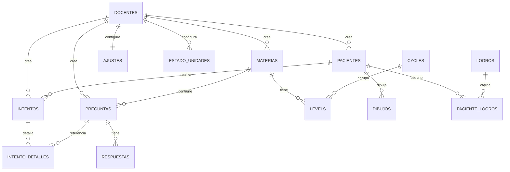

# Guía de Base de Datos — Trivia Educativa (estado real verificado)

Esquema: `app` en Supabase (PostgreSQL). RLS habilitado en todas las tablas. 14 tablas.

## 1. Inventario de tablas y columnas finales

| Tabla | Columnas principales |
|---|---|
| `app.docentes` | `id_docente` uuid PK (= auth.users.id), `email`, `nombre`, `rol` CHECK (docente/super_admin), `fecha_creacion` |
| `app.pacientes` | `id_paciente` uuid PK, `nombre`, `dni` nullable, `avatar_url`, `creado_por` uuid FK docentes (default auth.uid()), `fecha_creacion` |
| `app.materias` | `id_materia` uuid PK, `nombre`, `creado_por` uuid FK docentes, `es_publica` bool, `fecha_creacion` |
| `app.preguntas` | `id_pregunta` uuid PK, `id_materia` uuid FK materias, `texto_pregunta`, `ciclo` CHECK (Primer/Segundo Ciclo), `unidad`, `media_url`, `media_type`, `creado_por`, `fecha_creacion` |
| `app.respuestas` | `id_respuesta` uuid PK, `id_pregunta` uuid FK preguntas, `texto_respuesta`, `es_correcta`, `fecha_creacion` (índice único parcial: una correcta por pregunta) |
| `app.intentos` | `id_intento` uuid PK, `id_paciente` uuid FK pacientes, `nombre_materia`, `ciclo` CHECK, `respuestas_correctas`, `respuestas_incorrectas`, `puntaje_total`, `creado_por`, `fecha_creacion` |
| `app.intento_detalles` | `id_detalle` uuid PK, `id_intento` uuid FK intentos, `id_pregunta`, `id_respuesta_elegida`, `es_correcta`, `tiempo_respuesta_segundos`, `fecha_creacion` |
| `app.dibujos` | `id_dibujo` uuid PK, `id_paciente` uuid FK pacientes, `imagen_url`, `fecha_creacion` |
| `app.logros` | `id_logro` uuid PK, `nombre` UNIQUE, `descripcion`, `imagen_url`, `fecha_creacion` |
| `app.paciente_logros` | `id_paciente_logro` uuid PK, `id_paciente` uuid FK pacientes, `id_logro` uuid FK logros, `fecha_obtencion`; UNIQUE(id_paciente, id_logro) |
| `app.ajustes` | `id_docente` uuid PK FK docentes, `max_preguntas` int (default 10) |
| `app.estado_unidades` | `id_estado` uuid PK, `id_docente` uuid FK docentes, `id_materia`, `ciclo`, `unidad`, `habilitada` |
| `app.cycles` | `id` serial PK, `name` UNIQUE CHECK (Primer/Segundo Ciclo) |
| `app.levels` | `id` serial PK, `subject_id` uuid FK materias (ON DELETE CASCADE), `cycle_id` int FK cycles (ON DELETE CASCADE), `level_no` CHECK (1–3), UNIQUE(subject_id, cycle_id, level_no) |

## 2. Constraints y FKs destacadas

- `respuestas`: índice único parcial `uq_respuestas_una_correcta` sobre `(id_pregunta) WHERE es_correcta = true`.
- `paciente_logros`: UNIQUE(id_paciente, id_logro) tras deduplicación.
- `logros`: UNIQUE(nombre).
- `preguntas` / `intentos`: CHECK ciclo en ('Primer Ciclo','Segundo Ciclo').
- `levels`: CHECK level_no BETWEEN 1 AND 3.
- `docentes`: CHECK rol IN ('docente','super_admin').
- `pacientes.dni`: nullable.
- `dibujos.imagen_url`: reemplaza la antigua `imagen_b64`.
- `levels` recreada con `subject_id` uuid FK a `materias`.

## 3. Índices (15 + compuesto)

- `idx_dibujos_id_paciente`, `idx_estado_unidades_id_docente`
- `idx_intento_detalles_id_intento`, `_id_pregunta`, `_id_respuesta`
- `idx_intentos_creado_por`, `_id_paciente`
- `idx_levels_cycle_id`
- `idx_materias_creado_por`
- `idx_paciente_logros_id_logro`, `_id_paciente`
- `idx_pacientes_creado_por`
- `idx_preguntas_creado_por`, `_id_materia`
- `idx_respuestas_id_pregunta`
- `idx_preguntas_materia_ciclo_unidad` (compuesto)

## 4. Seguridad: RLS multi-docente y roles

- Roles reales en `app.docentes.rol` (CHECK docente/super_admin). Trigger `public.handle_new_docente()` crea la fila del docente al registrarse, con rol `docente`.
- `private.is_super_admin()` (esquema privado, migración 005): SECURITY DEFINER, solo authenticated/service_role. Reemplaza a `app.is_super_admin()`, que fue eliminada.
- Políticas RLS por tabla (migración 002): aislamiento por `creado_por` para docentes; super_admin ve todo. Catálogos (`cycles`, `levels`, `logros`) de solo lectura para docentes, escritura solo super_admin.
- `anon` revocado: sin USAGE en esquema `app`, sin SELECT/INSERT/UPDATE/DELETE en tablas ni secuencias. Default privileges cerrados.
- `authenticated`: SELECT/INSERT/UPDATE/DELETE en todas las tablas; USAGE/SELECT en secuencias.
- `service_role`: acceso total.

## 5. Trigger

- `public.handle_new_docente()`: SECURITY DEFINER, search_path `public, app`. Se dispara al crear usuario en `auth.users`. Inserta fila en `app.docentes`. Ejecución revocada para PUBLIC, anon, authenticated.

## 6. Migraciones aplicadas

1. `001_docentes_roles_y_permisos.sql` — rol, backfill, trigger, is_super_admin, GRANTs.
2. `002_rls_aislamiento_multidocente.sql` — políticas RLS estrictas.
3. `003_esquema_tesis_e_indices.sql` — dni nullable, defaults, checks, índice único, levels recreada, índices, ANALYZE.
4. `004_fix_multiple_permissive_policies.sql` — elimina políticas FOR ALL redundantes.
5. `005_cierre_advisors_final.sql` — is_super_admin a esquema private, pg_graphql deshabilitada.

## 7. Diagrama ER (Mermaid)

## 8. Advisors post-005 (verificado)

- Security: únicamente `auth_leaked_password_protection` (WARN, requiere plan Pro para activar).
- Performance: únicamente `unused_index` (INFO, 14 índices sin uso aún; no es error).
- Eliminados: `multiple_permissive_policies` (3 tablas), `authenticated_security_definer_function_executable` (`app.is_super_admin`), `pg_graphql_authenticated_table_exposed` (14 tablas).
- `pg_graphql` deshabilitada (el frontend no usa GraphQL).
